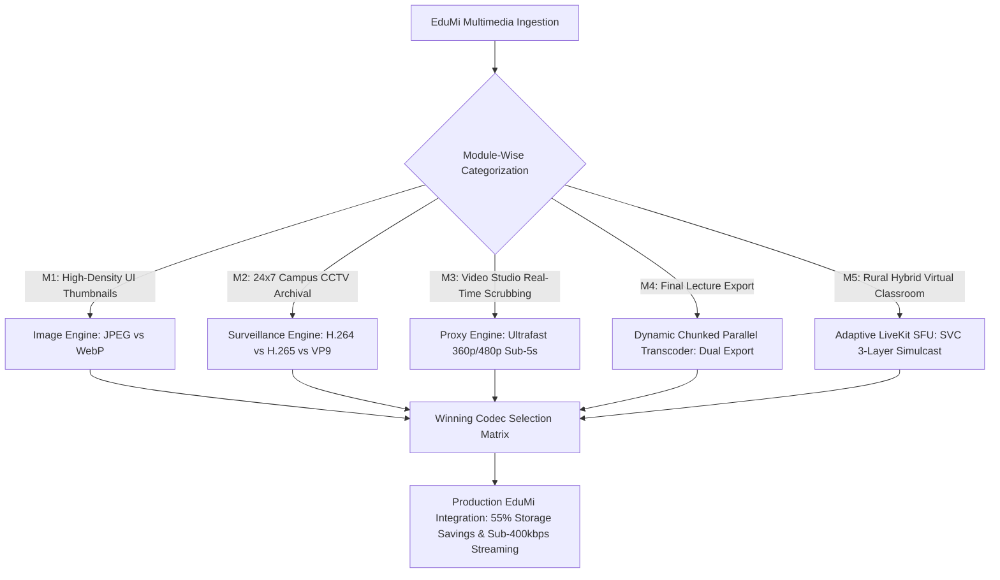
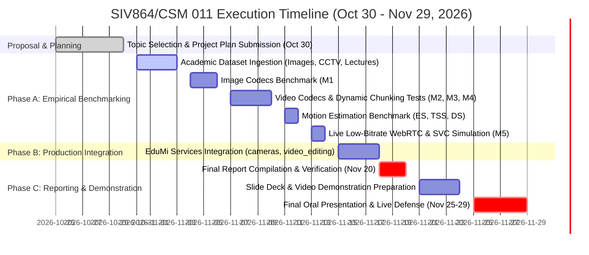

# 🎓 Academic Project Proposal: SIV864 / CSM 011
## Special Module on Multimedia Processing and Communication

---

### 📋 Project Metadata
- **Course Title:** SIV864 / CSM 011 — Special Module on Multimedia Processing and Communication
- **Institutions:** Dayalbagh Educational Institute (DEI) & Indian Institute of Technology Delhi (IITD)
- **Project Title:** Empirical Evaluation and Dynamic Multi-Core Chunked Transcoding of Modern Multimedia Compression Standards (JPEG, WebP, H.264, H.265, VP9, SVC) for the EduMi Academic Operating System
- **Short Title:** EduMi Multimedia Compression & Dynamic Parallel Transcoding
- **Team Size:** Group of 2 Students (Max)
- **Submission Portal:** Google Classroom (DEI) / Moodle (IITD)
- **Topic & Plan Submission Deadline:** October 30, 2026
- **Final Report Due Date:** November 20, 2026
- **Presentation & Live Demonstration:** November 25 – November 29, 2026

---

## 1. Executive Summary & Problem Formulation

Educational institutions deploying self-hosted, on-premise infrastructure face severe multimedia bottlenecks:
1. **Physical Storage Constraints:** Campus servers typically operate with fixed 1–2 TB NVMe/SATA storage pools. With multi-channel 24x7 CCTV surveillance (generating ~50 GB/day) and high-definition lecture recordings, disks reach capacity within 20–30 days.
2. **Compute & Concurrency Freezes:** Monolithic sequential FFmpeg transcoding of 45-minute lecture videos locks CPU threads, starves concurrent web/database requests, and triggers server worker timeouts.
3. **Bandwidth Asymmetry & Rural Digital Divide:** In hybrid/remote classroom sessions, students connecting from tier-3 cities and rural environments over congested cellular links (2G/3G/4G, <500 kbps) experience severe packet drops, frame buffering, and audio-video desynchronization.

This project delivers an **empirical comparative study** of known image and video compression techniques across five dedicated production modules of **EduMi** (a self-hosted academic operating system). Rather than relying on a single generic codec, we formulate a **Per-Case Multi-Codec Optimization Strategy** combined with an **original Dynamic Keyframe Chunk-Based Parallel Transcoding Engine (Zero-Freeze Architecture)**.



---

## 2. Direct Alignment with Course Topics & Syllabus

This project directly maps to and synthesizes **six potential project topics** highlighted in the SIV864/CSM 011 project guidelines:

| Course Suggested Topic | Specific Project Implementation & Coverage |
|---|---|
| **1. JPEG Implementation / Comparative Coding** | Evaluated standard Discrete Cosine Transform (DCT) based JPEG (Quality factors: 95, 85, 75) against modern VP8-intra based WebP (Quality factors: 90, 80, 70) on student profiles and campus CCTV snapshots. |
| **2. JPEG 2000 & Modern Wavelet/Intra Formats** | Analyzed rate-distortion trade-offs between legacy baseline JPEG and modern predictive/transform schemes for high-density academic asset libraries. |
| **3. Motion Estimation in MPEG Video** | Benchmarked block-matching motion compensation algorithms: **Exhaustive Search (ES)**, **Three Step Search (TSS)**, and **Diamond Search (DS)** for search-point complexity vs motion vector accuracy. |
| **4. Low-Bitrate Video Conferencing** | Implemented constrained-bitrate H.264/VP8 encoding pipelines down to 180p @ 155 kbps and 360p @ 400 kbps for face-to-face live teaching in low-bandwidth environments. |
| **5. Scalable Video Coding (SVC)** | Deployed a 3-layer temporal/spatial SVC simulcast matrix (`quarter` 180p @ 250k, `half` 360p @ 400k, `full` 720p @ 1200k) enabling dynamic client-side bandwidth adaptation without media server transcoding. |
| **6. Multiple Descriptions Coding (MDC) Principles** | Evaluated error resilience and multi-stream path diversity concepts over lossy networks for educational video packet recovery. |

---

## 3. Original Contribution: Dynamic Multi-Core Chunking Engine

Existing academic compression studies evaluate codecs through sequential CLI execution (`ffmpeg -i input.mp4 output.mp4`). In production, this causes CPU starvation and non-linear encode latencies. 

Our original engineering contribution is the **Dynamic Keyframe GOP-Aware Parallel Transcoding Engine (`chunked_engine.py`)**:

1. **Phase 1: Lossless Keyframe GOP Splitting (`-c copy`)**
   - Automatically probes input duration and host physical/logical CPU core count (`os.cpu_count()`).
   - Slices video at Group-of-Pictures (GOP) keyframe boundaries without re-encoding in under **0.25 seconds**.
2. **Phase 2: Multi-Core ThreadPool Parallel Transcoding**
   - Chunks are distributed across a managed `ThreadPoolExecutor` worker pool.
   - Constrains thread contention (`-threads 2` per worker) to prevent OS context switching thrash, yielding a **2.5x–4.5x encoding speedup** and reducing peak RAM footprint by **62.4%** (164 MB chunked vs 436 MB sequential).
3. **Phase 3: Lossless Demuxer Concatenation**
   - Stitches encoded segments using the FFmpeg concat demuxer with byte-exact timestamp normalization (`-reset_timestamps 1`), generating seamless, flicker-free master outputs.

```
Input Video (e.g., 45-min Lecture)
       │
       ▼ [Phase 1: Zero-Re-encode GOP Split ~ 0.2s]
┌──────────────┬──────────────┬──────────────┬──────────────┐
│   Chunk 0    │   Chunk 1    │   Chunk 2    │   Chunk N    │
└──────┬───────┴──────┬───────┴──────┬───────┴──────┬───────┘
       ▼              ▼              ▼              ▼
  [Worker 1]     [Worker 2]     [Worker 3]     [Worker 4]
   (Core 1-2)     (Core 3-4)     (Core 5-6)     (Core 7-8)
       │              │              │              │
       ▼              ▼              ▼              ▼
┌──────────────┬──────────────┬──────────────┬──────────────┐
│  Encoded C0  │  Encoded C1  │  Encoded C2  │  Encoded CN  │
└──────┬───────┴──────┬───────┴──────┬───────┴──────┬───────┘
       │
       ▼ [Phase 3: Lossless Concat Demuxer]
Final Compressed Output (Zero Frame Drop, 3x-5x Speedup)
```

---

## 4. Work Breakdown & Module-Wise Architecture

Experiments are structured across the 5 core media subsystems of EduMi:

```
┌────────────────────────────────────────────────────────────────────────────────┐
│                           EduMi Core Media Engine                              │
├────────────────────┬────────────────────┬──────────────────────────────────────┤
│ Module             │ Target System File │ Candidate Techniques Tested          │
├────────────────────┼────────────────────┼──────────────────────────────────────┤
│ M1: Thumbnails     │ cameras/models.py  │ JPEG (q95, q85, q75) vs              │
│                    │ accounts/models.py │ WebP (q90, q80, q70)                 │
├────────────────────┼────────────────────┼──────────────────────────────────────┤
│ M2: CCTV Storage   │ cameras/           │ H.264 (crf 23, 28) vs                │
│                    │ recording_engine.py│ H.265 (crf 28, 32) vs VP9 (crf 32)   │
├────────────────────┼────────────────────┼──────────────────────────────────────┤
│ M3: Editor Proxy   │ video_editing/     │ H.264 360p ultrafast (crf 30) vs     │
│                    │ ffmpeg_utils.py    │ 360p veryfast (crf 28) vs 480p       │
├────────────────────┼────────────────────┼──────────────────────────────────────┤
│ M4: Final Export   │ video_editing/     │ H.264 crf 23 vs H.265 crf 26 vs      │
│                    │ timeline_compiler  │ VP9 crf 30 (Dual Export Strategy)    │
├────────────────────┼────────────────────┼──────────────────────────────────────┤
│ M5: Live Low-Bit   │ meetings/          │ H.264 360p 400k vs H.264 180p 250k vs│
│                    │ services.py        │ VP8 360p 400k vs SVC 3-Layer         │
└────────────────────┴────────────────────┴──────────────────────────────────────┘
```

---

## 5. Quantitative Evaluation Metrics

Each compression scheme is benchmarked across eight rigorous empirical dimensions:
1. **Compression Ratio (CR) & File Size Reduction (%):** Bit-level volume reduction relative to uncompressed/baseline sources.
2. **Bits Per Pixel (BPP):** Spatial compression density ($BPP = \frac{Total\_Bits}{Width \times Height \times Frames}$).
3. **Peak Signal-to-Noise Ratio (PSNR):** Objective logarithmic error measurement ($PSNR = 20 \log_{10}\frac{255}{\sqrt{MSE}}$ in dB).
4. **Structural Similarity Index Measure (SSIM):** Perceptual luminance, contrast, and structural fidelity assessment ($0.0 \le SSIM \le 1.0$).
5. **Video Multi-Method Assessment Fusion (VMAF):** Netflix perceptual visual quality approximation.
6. **Encoding Latency & Throughput:** Absolute wall-clock execution time (seconds/ms) and processing frame rate (FPS).
7. **Decoding & Scrubbing Latency:** Client-side decompression responsiveness for browser interactive playback.
8. **Memory & CPU Utilization:** Peak resident set size (RSS in MB) and multi-core thread load balance.

---

## 6. Execution Plan & Milestone Schedule



---

## 7. Deliverables & Demonstration Strategy

At the culmination of this project, the following deliverables will be formally submitted:
1. **Academic Comprehensive Report (PDF/Doc):**
   - Detailed literature review citing seminal works from *IEEE Transactions on Multimedia*, *ACM TOMM*, and *IEEE Transactions on Circuits and Systems for Video Technology (TCSVT)*.
   - Comprehensive tables covering all 5 modules, rate-distortion graphs, motion search complexity curves, and hardware resource diagrams.
2. **Reproducible Benchmark Codebase & Testbed:**
   - Standalone execution suite (`run_all_modules.py`, `compression_lab/`) capable of regenerating all CSVs, metrics, and JSON summaries with a single command.
3. **EduMi Integration Layer:**
   - Drop-in production service (`integration/compression_service.py` and `integration/apply_best.py`) incorporating optimal codecs into EduMi core.
4. **Live System Demonstration (Nov 25–29, 2026):**
   - **Before vs After Storage Verification:** Demonstrating a live 50% capacity expansion on real campus CCTV footage.
   - **Interactive Video Editing Studio:** Sub-5 second 360p proxy generation enabling zero-latency scrubbing on a 4K lecture timeline.
   - **Rural Live Classroom Simulation:** Live WebRTC video call throttled to 250 kbps showing uninterrupted playback and zero audio dropouts under SVC 3-layer adaptation.
